<div align="center">

# 🔥 Agni-Pulse

**Your phone camera as a pulse lab.**
See how your own body responds to meals, coffee, stress and simple practices, with nothing but a smartphone.

[](https://github.com/ZephyriumX/Agni/actions/workflows/backend.yml)


-E2570B)

[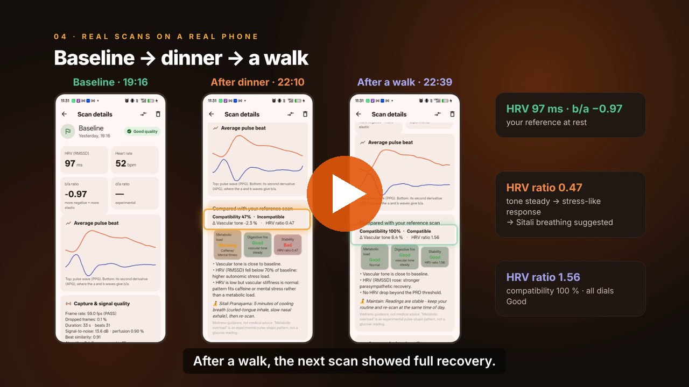](docs/media/agni-pulse-demo.mp4)

▶️ **[Watch the 72-second demo](docs/media/agni-pulse-demo.mp4)** (narrated, with captions)

</div>

> **Wellness tool, not a medical device.** Agni-Pulse reports changes against *your own* baseline. It does not diagnose
> anything and never estimates blood glucose.

---

## What it does

Rest a fingertip on the rear camera and torch for **35 seconds**. Agni-Pulse then:

1. **checks the recording itself**: real frame timing, steadiness and signal quality. A bad scan is refused, not guessed;
2. computes **heart rate**, **HRV (RMSSD)** and the **APG b/a ratio**, a published marker of arterial stiffness;
3. **compares the scan with your own baseline** and explains the result in plain language;
4. **suggests a short practice** when the response is unfavourable (for example Sitali breathing or Vajrasana), then
   **measures whether it helped** on the next scan;
5. builds **personal analytics** over time: your normal range, trends, the meals that suit you and the habits that help.

<table>
<tr>
<td align="center">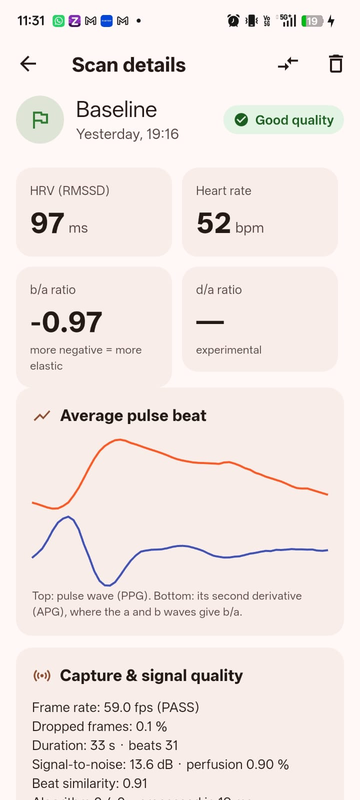<br><sub><b>Baseline at rest</b><br>HR 52 · RMSSD 97 ms · b/a −0.97</sub></td>
<td align="center">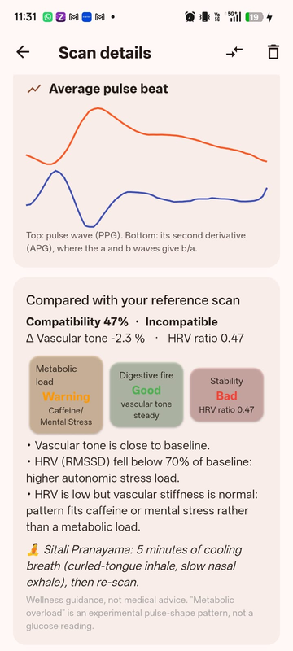<br><sub><b>After dinner</b><br>HRV ratio 0.47 → breathing suggested</sub></td>
<td align="center">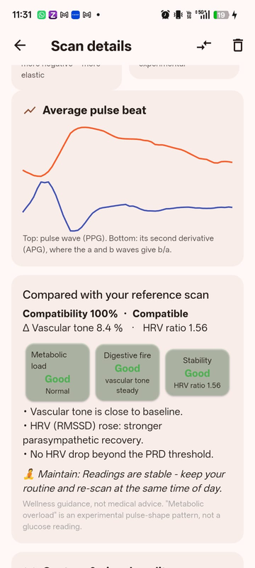<br><sub><b>After a walk</b><br>HRV ratio 1.56 · compatibility 100 %</sub></td>
</tr>
</table>

<sub>Real screenshots from the app on an Android phone (realme P3 5G), 19 Nov 2026.</sub>

---

## Real-device results

The app was installed on a **realme P3 5G** and used against the cloud back end (Supabase PostgreSQL). Three
consecutive baselines, as displayed in the app:

| Baseline | Heart rate | RMSSD | b/a | Frame rate | Dropped frames | SNR | Beat similarity |
|---|---|---|---|---|---|---|---|
| 19:12 | 53 bpm | 125 ms | −0.93 | 59.1 fps ✅ | 0.0 % | 13.3 dB | 0.91 |
| 19:14 | 54 bpm | 146 ms | −0.95 | 59.0 fps ✅ | 0.1 % | 14.6 dB | 0.96 |
| 19:16 | 52 bpm | 97 ms  | −0.97 | 59.0 fps ✅ | 0.1 % | 13.6 dB | 0.91 |

* Every capture **passed the timing gate** at ~59 fps with essentially no frame loss.
* **b/a is repeatable within ±2 %** across consecutive baselines.

### Meal → suggestion → recovery

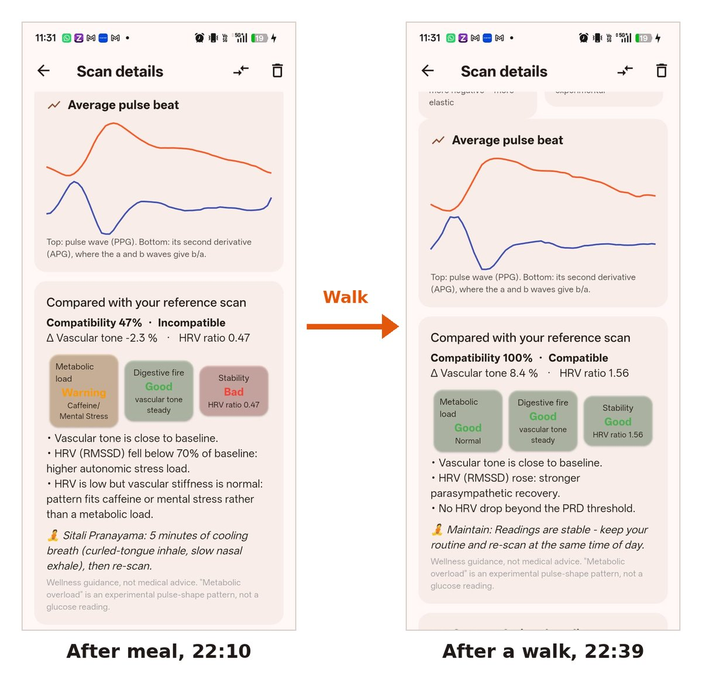

After dinner, RMSSD fell from 97 to 45 ms (HRV ratio **0.47**) while vascular tone stayed within 2.3 %. The context gate
read this as a **stress-like response** rather than a metabolic load and suggested Sitali breathing. After a short walk,
RMSSD was back to 152 ms (HRV ratio **1.56**) and all three dials were **Good**.

### Stored in the cloud

Every scan is stored with its **full raw signal**, measured sampling rate, metrics, quality verdict and algorithm version,
so it can be re-analysed later.

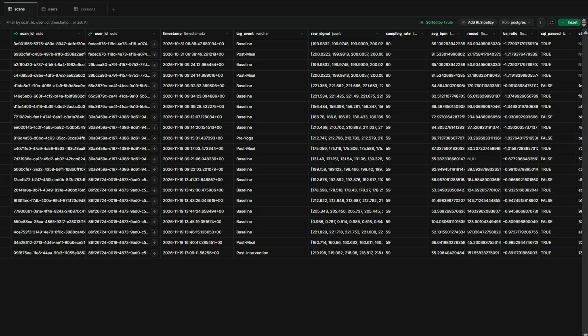

---

## How it works

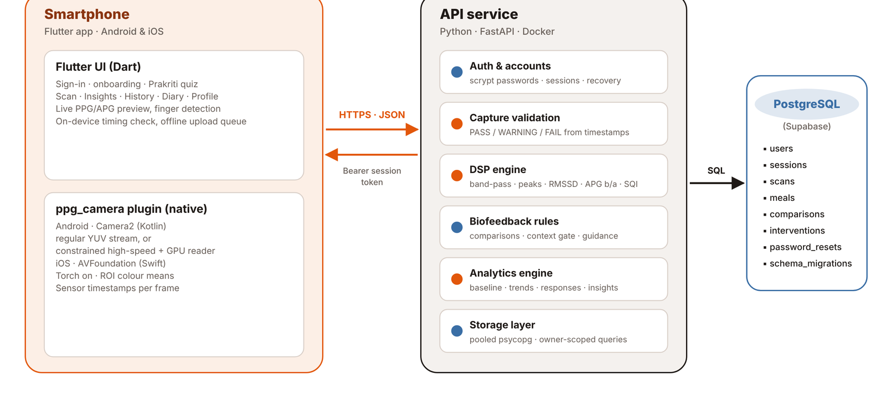

| Stage | What happens |
|---|---|
| **Capture** (Kotlin Camera2 / Swift AVFoundation) | Torch on, autofocus off, white balance fixed to daylight, 8 ms exposure, ISO tuned and then locked. Each frame sends its **sensor timestamp** and the mean R, G, B of the central 50 % of the image. A pre-scan check waits for a finger before recording. |
| **Timing gate** | Mean and median fps (≥ 58 to pass, ≥ 55 minimum), dropped frames, longest gap, jitter and 2-second windows. The signal is analysed at the **measured** rate and is never relabelled as 60 fps. |
| **Signal engine** (NumPy / SciPy) | Invert and trim → 4th-order zero-phase Butterworth 0.5–5 Hz → VPG and APG by central differences → systolic peaks with sub-sample refinement → cleaned beat intervals → **HR, RMSSD, median b/a** and an averaged beat. |
| **Quality gate** | Seven checks: perfusion, saturation, beat count, SNR, beat-shape consistency, motion bursts and interval regularity. |
| **Context engine** | Δ tone = (b/a test − b/a base) / \|b/a base\|; HRV ratio = RMSSD test / RMSSD base. A low HRV ratio with steady tone suggests caffeine or stress; a low ratio with stiffer tone is an experimental metabolic-load pattern. |
| **Analytics** | Personal mean ± SD, z-scores with noise floors, trends, meal and descriptor rankings, interventions paired with the scan before them, insights with confidence levels. |

<details>
<summary><b>Signal-processing pipeline and waveforms</b></summary>

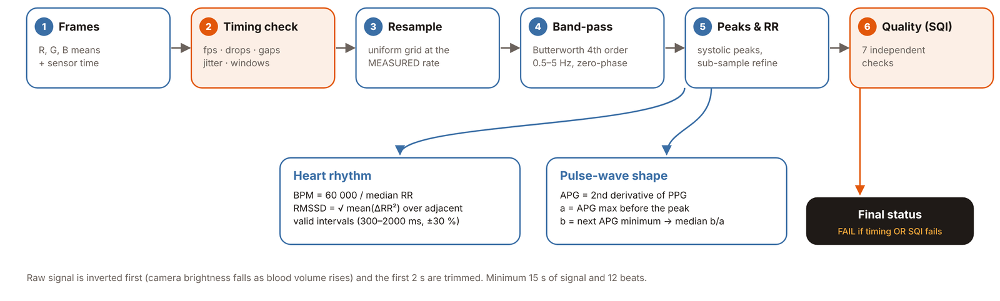
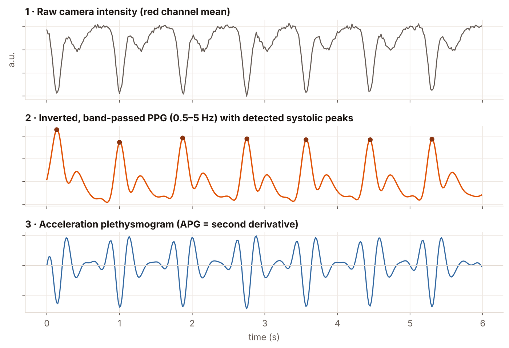
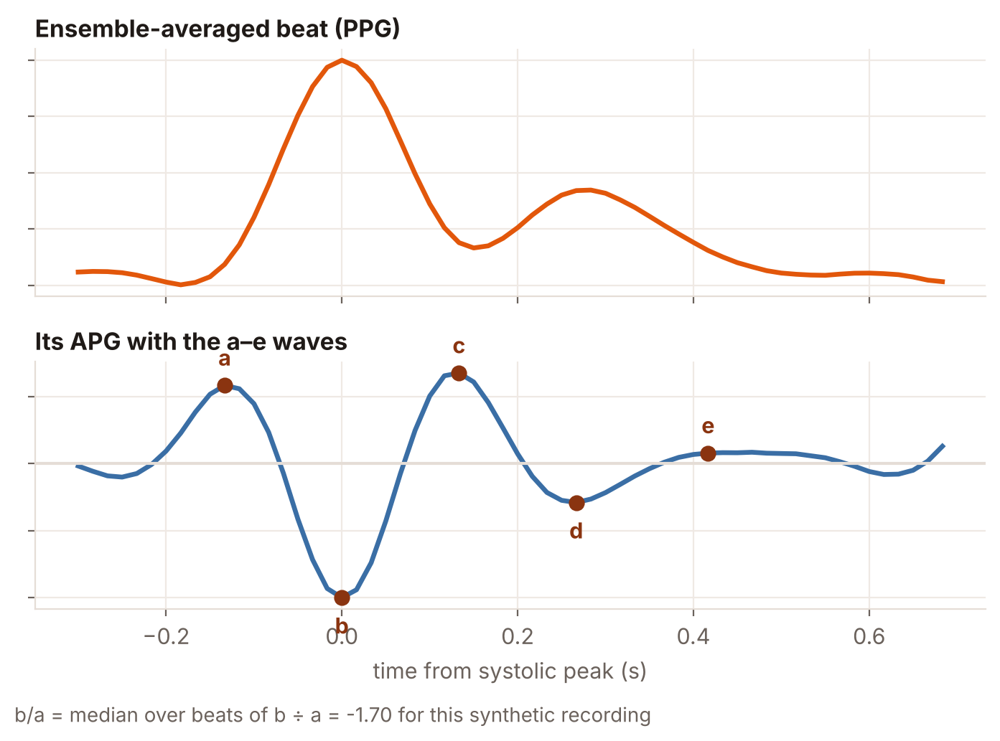
</details>

<details>
<summary><b>Camera capture paths, data model and analytics</b></summary>

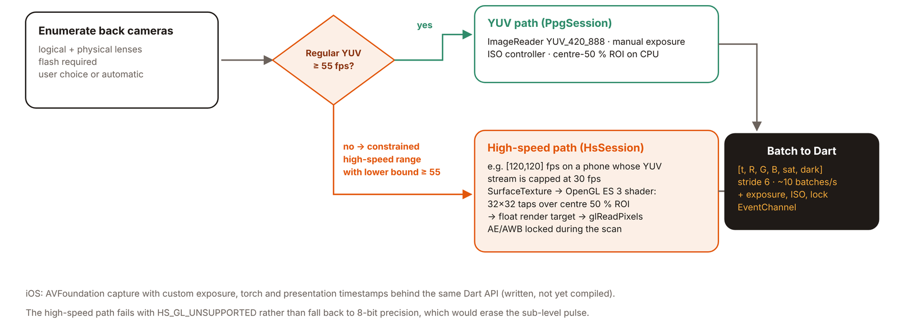
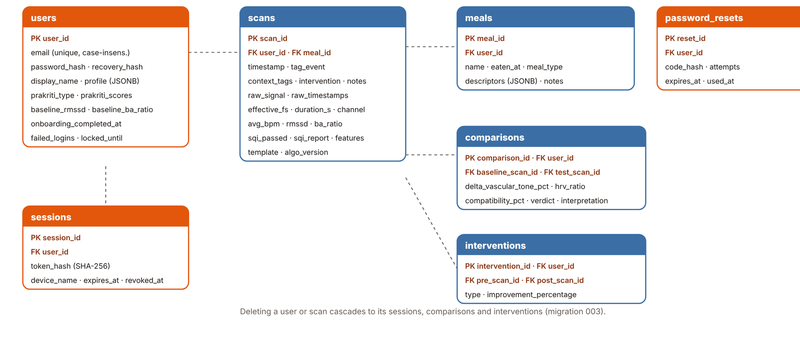
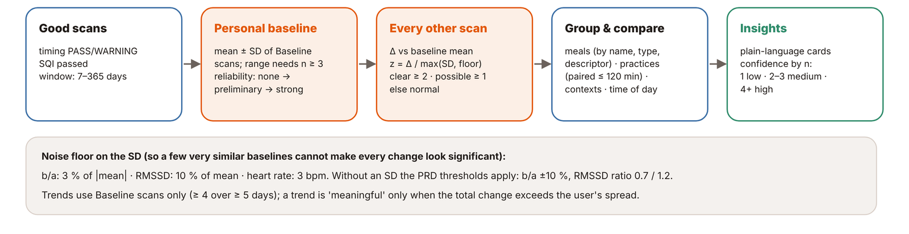
</details>

---

## Verification

| Level | Result |
|---|---|
| Automated tests (pytest, in-memory **and** real PostgreSQL 16, run in CI) | **165 / 165 pass** |
| Live end-to-end check against a production-mode server (`scripts/smoke_remote.py`) | **20 / 20 steps pass** |
| Accuracy on 20 synthetic recordings with known truth (55–93 bpm) | HR error **0.58 bpm** mean (1.45 max) · RMSSD error **5.5 %** mean |
| Artefact rejection (motion, bursts, noise, pressure steps, flat lines) | **100 / 100** corrupted rejected · **20 / 20** clean accepted |
| Processing time per 35-second scan | **4.5 ms** median |
| Manual testing on a real phone | Scans on 16, 18 and 19 Nov 2026, stored in Supabase (see above) |

<p>
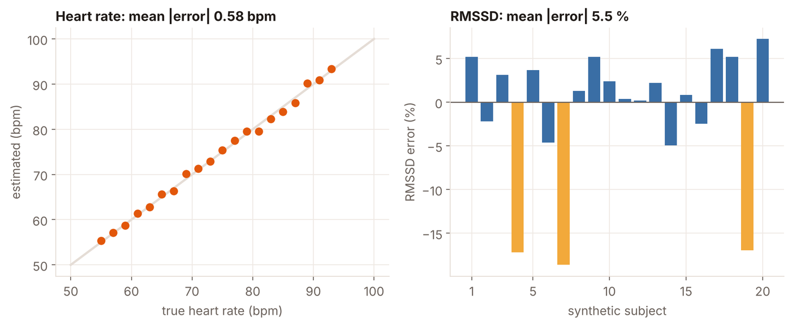
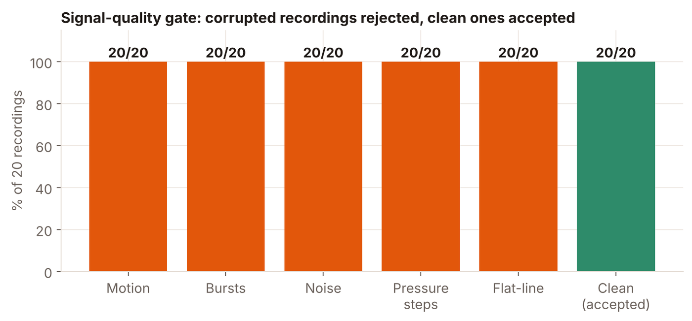
</p>

Accuracy and artefact figures come from **simulated** recordings with exactly known values. Device scans were made by
the project team. Neither is a clinical or participant study.

---

## Features

* **Accounts**: e-mail and password, one session per device, sign out everywhere, change password, one-time recovery code
  (plus optional e-mailed reset codes), and account deletion with all data.
* **Onboarding**: profile, goals and a 12-question Prakriti self-assessment with dosha scores.
* **Scans**: baseline, after meal, after an intervention (Vajrasana, Sitali, breathing, meditation, walk, yoga…), after
  exercise, with contexts (caffeine, stress, poor sleep, fasting…) and notes. Guided Vajrasana: scan → 10-min timer → scan.
* **Insights**: personal normal range, trend charts with the normal band, scan-vs-baseline significance, meal and
  intervention effects, context effects, time-of-day pattern, quality summary and plain-language insights.
* **History, compare any two scans, food diary, data export.**
* **Remote access**: Docker image and `render.yaml` for a free Render + Supabase deployment, so the phone works anywhere.

---

## Repository layout

```
backend/          FastAPI service: auth, dsp_engine.py, capture_validation.py, analytics.py, storage, tests/
db/migrations/    001_init · 002_hardening · 003_accounts_analytics
app/              Flutter app (lib/, test/, tools/setup_ios.sh)
  packages/ppg_camera/   android/ (Kotlin Camera2 + high-speed GPU reader) · ios/ (Swift AVFoundation)
scripts/          smoke_remote.py · e2e_check.py · run_dev.ps1 · tunnel.ps1/.sh · simulate_scan.py
docs/             setup guides, CAPTURE_VALIDATION, CAMERA_SELECTION, STATUS, media/
render.yaml       one-click cloud deployment (Render Blueprint)
```

---

## Getting started

### 1. Back end

For use anywhere (any network, no cable), deploy to the cloud with [`docs/REMOTE_ACCESS.md`](docs/REMOTE_ACCESS.md)
(Render + Supabase free tiers, about 20 minutes). To run it locally:

```bash
cd backend
python3 -m venv .venv && source .venv/bin/activate
pip install -r requirements.txt
export DATABASE_URL="postgresql://..."      # your Supabase/PostgreSQL URI. Never commit it.
python migrate.py                            # applies db/migrations/*.sql once each (checksummed)
uvicorn main:app --host 0.0.0.0 --port 8000
curl http://127.0.0.1:8000/ready             # database reachable and migrated
```

```powershell
# Windows PowerShell (from the repo root): venv, deps, migrations, adb reverse, uvicorn
$env:DATABASE_URL = "postgresql://...."
.\scripts\run_dev.ps1                 # real database
.\scripts\run_dev.ps1 -Memory         # throw-away (data lost on exit)
.\scripts\run_dev.ps1 -Lan            # also listen on Wi-Fi (needs scripts\windows_firewall.ps1 once)
```

Docker: `docker compose up --build`. Without `DATABASE_URL` the server refuses to start. Environment variables are listed
in `.env.example` (copy to `.env`, which is git-ignored).

### 2. Android phone → [`docs/ANDROID_SETUP.md`](docs/ANDROID_SETUP.md)

```powershell
cd app
flutter pub get
adb reverse tcp:8000 tcp:8000      # when the back end runs on your PC
flutter run                        # or: flutter run --dart-define=API_BASE_URL=https://<your-api>.onrender.com
```

### 3. iPhone (needs a Mac with Xcode) → [`docs/IOS_SETUP.md`](docs/IOS_SETUP.md)

```bash
cd app && ./tools/setup_ios.sh
open ios/Runner.xcworkspace
flutter run -d <your-iphone> --dart-define=API_BASE_URL=https://<your-api>.onrender.com
```

### 4. Tests

```bash
cd backend && pip install -r requirements-dev.txt && python -m pytest -q      # 165 tests
python scripts/smoke_remote.py https://<your-server>                           # live end-to-end check (20 steps)
```

---

## Security and privacy

* Passwords hashed with scrypt (per-user salt). Session tokens, recovery codes and reset codes are random and stored only
  as SHA-256 hashes. Identity always comes from the token, and every query is scoped to the owner.
* Login rate limit and account lockout; optional invitation key (`AGNI_REGISTRATION_KEY`); sign-up can be closed.
* Body-size limit, no logging of bodies, tokens or signals, row-level security on all tables, secrets only in
  environment variables. `.env`, keystores and connection strings are git-ignored.

---

## Status and roadmap

Per-component verification is in [`docs/STATUS.md`](docs/STATUS.md).

* ✅ Back end, analytics and database: automated, live and cloud-tested.
* ✅ Android app with the regular Camera2 path: built and tested on a realme P3 5G at ~59 fps.
* 🔜 iPhone build, and the high-speed camera path for phones whose normal stream is capped at 30 fps, on real hardware.
* 🔜 A participant study against ECG and a reference pulse-wave device.
* 🔜 Breathing rate from PPG, the full APG ageing index, and learned per-user models once enough labelled scans exist.

All thresholds are engineering parameters, and nothing in this repository is clinically validated.

<details>
<summary><b>From the planning board</b></summary>

Design sessions that shaped the capture procedure, the markers and the recommendation loop:

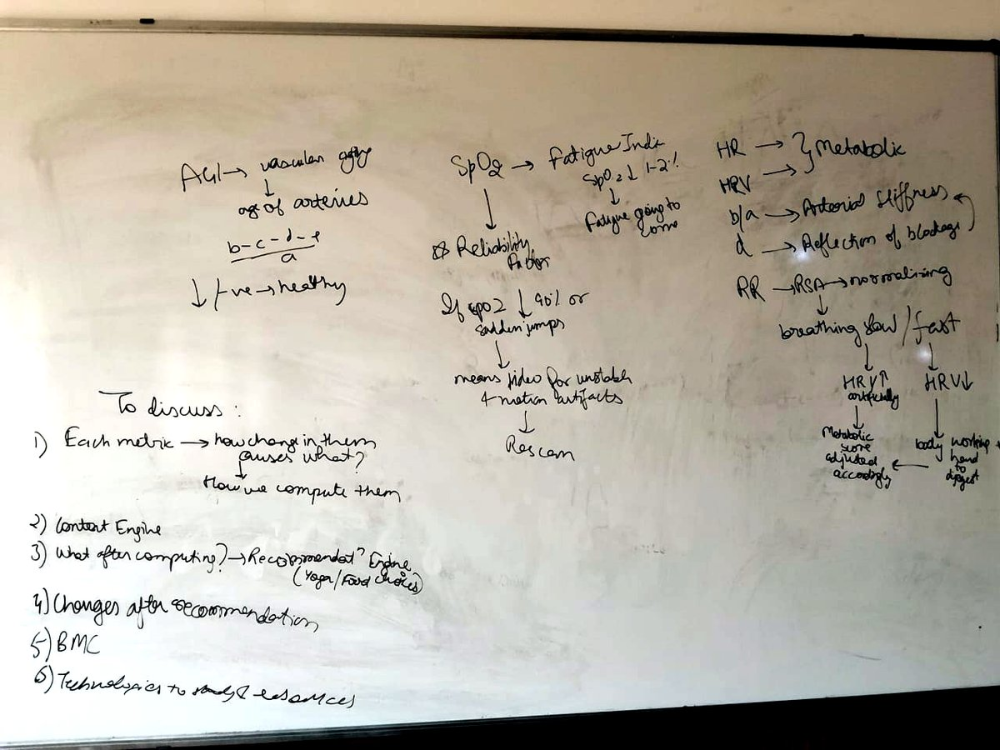
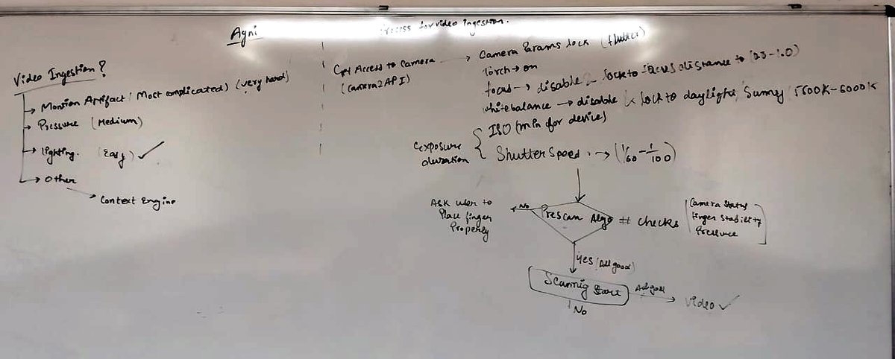
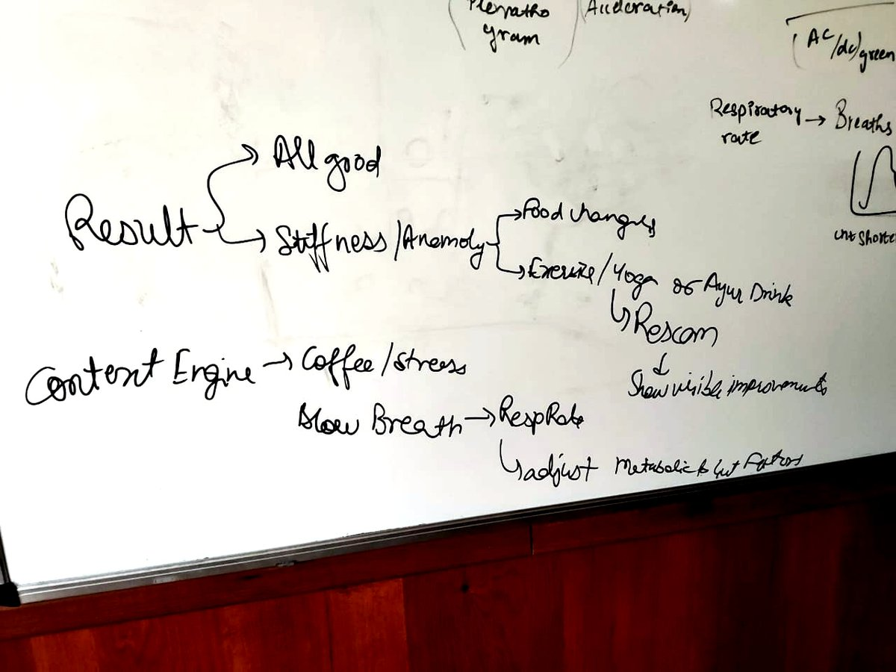
</details>

---

## Team

**Uttam Singh** (23CSU326) · **Mehul Khanna** (23CSU198)
Department of CSE & IT, The NorthCap University, Gurugram, final-year project 2026–27.

<sub>Demo narration generated with [Kokoro](https://github.com/hexgrad/kokoro) (Apache-2.0), voice af_heart.</sub>
